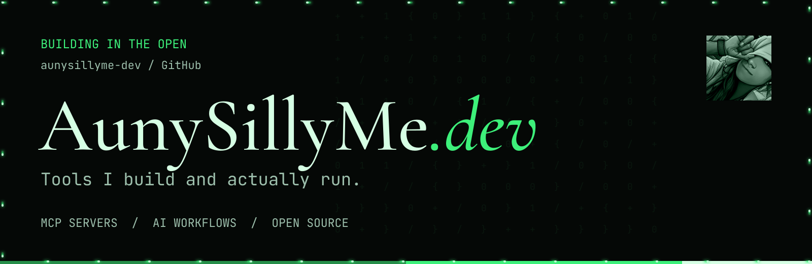

  

  
  
  

I'm [Auny](https://github.com/aunysillyme). This is where I share the agent skills, plugins, and tools behind my AI setup. I build them for my own work, then open-source what other people can use.

## 

### [aunx-decompose](https://github.com/aunysillyme-dev/aunx-decompose)

Split a task into the smallest checkable units and parallel waves before any agent starts. One skill with plugins for Claude Code, Codex, Gemini CLI, Cursor, Copilot CLI, OpenCode and Qwen Code, and a checker that rejects bad plans.

[Source & install](https://github.com/aunysillyme-dev/aunx-decompose#readme) · [npm](https://www.npmjs.com/package/aunx-decompose)

### [aunx-skills](https://github.com/aunysillyme-dev/aunx-skills)

Ten agent skills for Claude Code, Codex, Cursor and Gemini CLI. Decompose also installs from here through [skills.sh](https://skills.sh/aunysillyme-dev/aunx-skills/decompose) and my Claude Code plugin marketplace.

[Browse the skills](https://github.com/aunysillyme-dev/aunx-skills#readme)

## 

My open-source tools live on my personal account, [@aunysillyme](https://github.com/aunysillyme).

- **[model-orchestrator](https://github.com/aunysillyme/model-orchestrator):** route work across your AI coding tools, with routine work on cheaper models.
- **[agent-personalizer](https://github.com/aunysillyme/agent-personalizer):** one profile and instructions for every AI you use.
- **[website-build-skill](https://github.com/aunysillyme/website-build-skill):** teach your AI to research, design, build, and review websites.
- **[repo-build-skill](https://github.com/aunysillyme/repo-build-skill):** teach your AI to build, release and launch a GitHub repo.
- **[lean-browser-use](https://github.com/aunysillyme/lean-browser-use):** cut browser use cost in Claude Code by about 25%.
- **[lean-computer-use](https://github.com/aunysillyme/lean-computer-use):** background Mac control for AI agents, installed with one command.

[Browse my npm packages](https://www.npmjs.com/~aunysillyme)

## 

Small things I build to see what happens.

- **[hearsay](https://github.com/aunysillyme/hearsay):** pass a message down the line, then see who changed it.
- **[seconded](https://github.com/aunysillyme/seconded):** a concern is heard when a second person has it too.
- **[wat-we-building](https://github.com/aunysillyme/wat-we-building):** five questions before the AI builds.

## 

Demos and project guides on [aunysillyme.dev](https://aunysillyme.dev). What I'm building and learning on [X](https://x.com/AunySillyMe) and [my blog](https://aunysillyme.com/blog).

Questions about a tool? Open an issue in its repository so the context stays with the project.

Branding and marketing consulting: [aunysillyme.com](https://aunysillyme.com).
